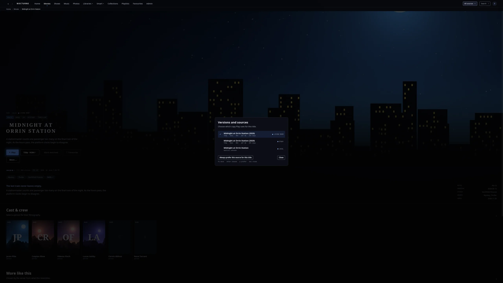
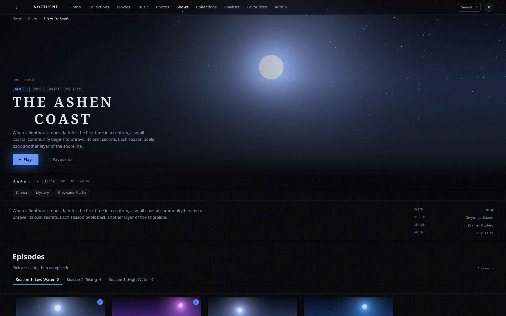
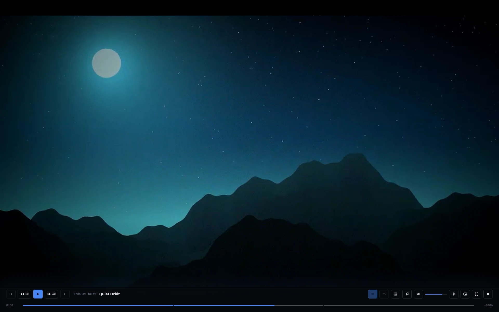
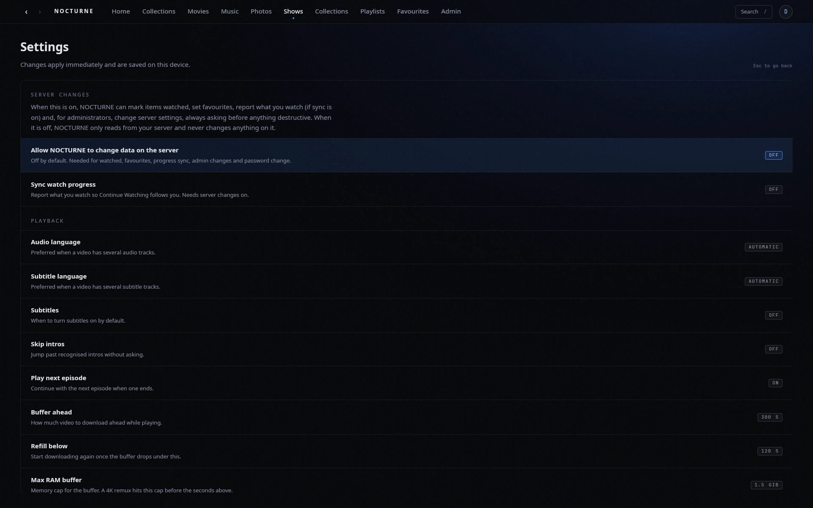

<p align="center"></p>

# NOCTURNE

**YOUR MEDIA. YOUR NIGHT.**

A native, cinematic desktop client for Jellyfin on Linux. Written in Rust with [GPUI](https://www.gpui.rs/),
playing video in the app window through libmpv. Wayland first.

Status: version 0.1.0, early. Linux only. See [docs/ROADMAP.md](docs/ROADMAP.md) for what is missing.

## Screenshots

Captured against a generated demo library, not personal media.

|                                               |                                           |
| --------------------------------------------- | ----------------------------------------- |
|            |  |
|  |    |
|        |    |
|    |      |

## What it does

The full checklist is [docs/FEATURES.md](docs/FEATURES.md); verification notes are in
[docs/QA_REPORT.md](docs/QA_REPORT.md).

- **Browse**: home with Continue Watching and Next Up, paged libraries with sort, filters, A-Z and poster / thumb / list views,
  genres, studios, years, tags, collections, playlists and favourites, global search (Ctrl+K or `/`), people pages.
- **Details**: movie, series, season and episode pages with cast, chapters, similar items, extras and media info.
- **Playback**: in-window GPU video via libmpv with hardware decoding, chapters and trickplay on the seek bar,
  audio and subtitle menus with delays and styling, speed and picture controls, skip intro and credits,
  next-episode autoplay, queue, quality selector with transcode fallback, mini player, MPRIS and idle inhibit.
- **Accounts**: username and password or Quick Connect; the token lives in your system keyring.
- **Admin** (administrator accounts): dashboard, users, libraries, scheduled tasks, devices, activity, logs, API keys
  and several server settings, each change behind a confirmation dialog.

Not implemented: Live TV, SyncPlay, DLNA, casting, gapless music, playable books and audiobooks, and some admin
editing. Windows and macOS are not supported.

## Install

NOCTURNE needs mpv's library (`libmpv`), a Vulkan driver (GPUI renders with Vulkan), an OpenGL/EGL stack, and a
Secret Service provider (gnome-keyring, KWallet or KeePassXC) to remember your login. Packages are tested on Arch
Linux only; see [docs/PACKAGING.md](docs/PACKAGING.md) for the full dependency list.

**Release tarball** (from the GitHub Releases page, once published):

```sh
tar xf nocturne-0.1.0-x86_64-linux.tar.gz && cd nocturne-0.1.0-x86_64-linux
sudo ./install.sh              # PREFIX=/usr/local by default; `sudo ./install.sh uninstall` removes it
```

**Arch Linux** (builds from the source archive of the release tag):

```sh
cd packaging && makepkg -si
```

**From source**:

```sh
# Arch: sudo pacman -S rust mpv pkgconf libxkbcommon-x11 vulkan-icd-loader
# Debian/Ubuntu (names may differ): libmpv-dev pkg-config libxkbcommon-x11-dev libvulkan1 libwayland-dev libdbus-1-dev
git clone https://github.com/ifsvivek/nocturne && cd nocturne
cargo build --release --locked      # needs stable Rust 1.89+ and `pkg-config --modversion mpv` to succeed
./target/release/nocturne
```

A clean release build takes several minutes (fat LTO).

## Usage notes

- **X11.** In-window video needs Wayland. On other sessions NOCTURNE plays in an external mpv window, which closes
  with the app. `NOCTURNE_VIDEO=external` forces this on Wayland too.
- **Fonts.** The UI uses Noto Sans and JetBrainsMono Nerd Font if installed, and falls back to system fonts.

## Configuration and keyring

- Settings: `$XDG_CONFIG_HOME/nocturne/settings.toml` (default `~/.config/nocturne/`). It holds preferences only.
- Remembered servers: `$XDG_CONFIG_HOME/nocturne/servers.toml`, URLs only.
- Login token: your system keyring (Secret Service), never a file. If no Secret Service is running, NOCTURNE cannot
  remember the login.
- Developer mode: `NOCTURNE_JF_URL` and `NOCTURNE_JF_TOKEN` (a Jellyfin API key, read from the environment or a
  git-ignored `.env`) skip sign-in. This mode is strictly read-only.

## Safety model: read-only by default

NOCTURNE changes nothing on your server unless you say so. One setting,
**Settings > Allow NOCTURNE to change data on the server** (`allow_server_writes`), is off by default and gates
everything that writes: playback progress, watched and favourite flags, own password, and every admin action.
Admin actions additionally need an administrator account and a confirmation dialog. Signing in and out only creates
and ends this app's own session. The browsing and playback crate is GET-only and a test enforces it.
Details and the full table: [docs/WRITES.md](docs/WRITES.md).

## Contributing and AI-agent friendly

Contributions are welcome: see [CONTRIBUTING.md](CONTRIBUTING.md) for setup, the throwaway-server test workflow and
the ground rules. The repository is set up so coding agents can work in it safely: [CLAUDE.md](CLAUDE.md) (also
referenced from [AGENTS.md](AGENTS.md)) has the crate map, commands and safety rules, and
[docs/ARCHITECTURE.md](docs/ARCHITECTURE.md) explains how the pieces fit together.

## Documentation

[Features](docs/FEATURES.md) | [Architecture](docs/ARCHITECTURE.md) | [Design](docs/DESIGN.md) |
[Roadmap](docs/ROADMAP.md) | [Writes](docs/WRITES.md) | [Packaging](docs/PACKAGING.md) | [QA report](docs/QA_REPORT.md) |
[Contributing](CONTRIBUTING.md) | [Security](SECURITY.md) | [Changelog](CHANGELOG.md)

## License

GPL-3.0-or-later. See [LICENSE](LICENSE); third-party licences are listed in
[THIRD_PARTY_NOTICES.md](THIRD_PARTY_NOTICES.md).

## Acknowledgements and attribution

- **[Jellyfin](https://jellyfin.org/)** is the media server NOCTURNE talks to. "Jellyfin" and its logo are trademarks of
  the Jellyfin project. NOCTURNE is an unofficial third-party client; it is not affiliated with, endorsed by or
  sponsored by Jellyfin, and uses the name only to say which server it works with.
- **[GPUI](https://github.com/zed-industries/zed)** by Zed Industries, the UI framework (Apache-2.0).
- **[mpv](https://mpv.io/) / libmpv** for playback and hardware decoding.
- **[Rust](https://www.rust-lang.org/)** and the crates NOCTURNE builds on, including tokio, reqwest, rustls, serde, zbus,
  keyring, wayland-client and image. The full list with licences is in [THIRD_PARTY_NOTICES.md](THIRD_PARTY_NOTICES.md).
- `vendor/xattr` is a patched copy of the [xattr](https://github.com/Stebalien/xattr) crate (MIT / Apache-2.0).

---

> **Unofficial. Not affiliated with, endorsed by or sponsored by the Jellyfin project.**
> NOCTURNE is an independent client that talks to your own Jellyfin server over its public API.
