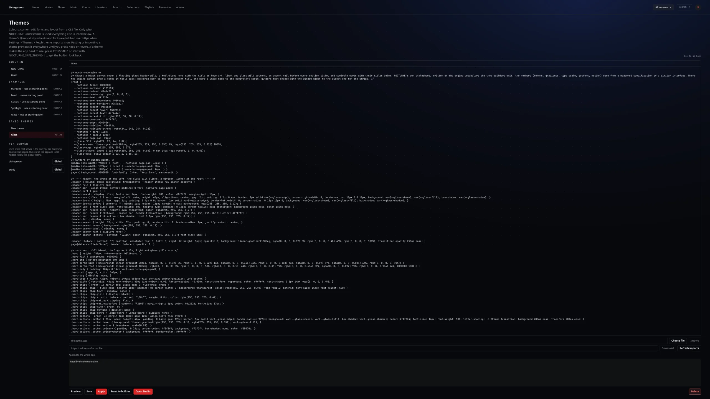
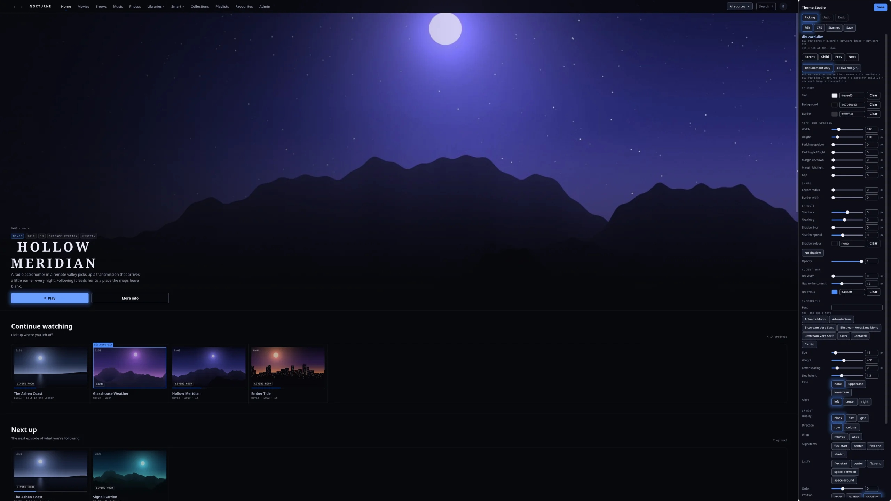
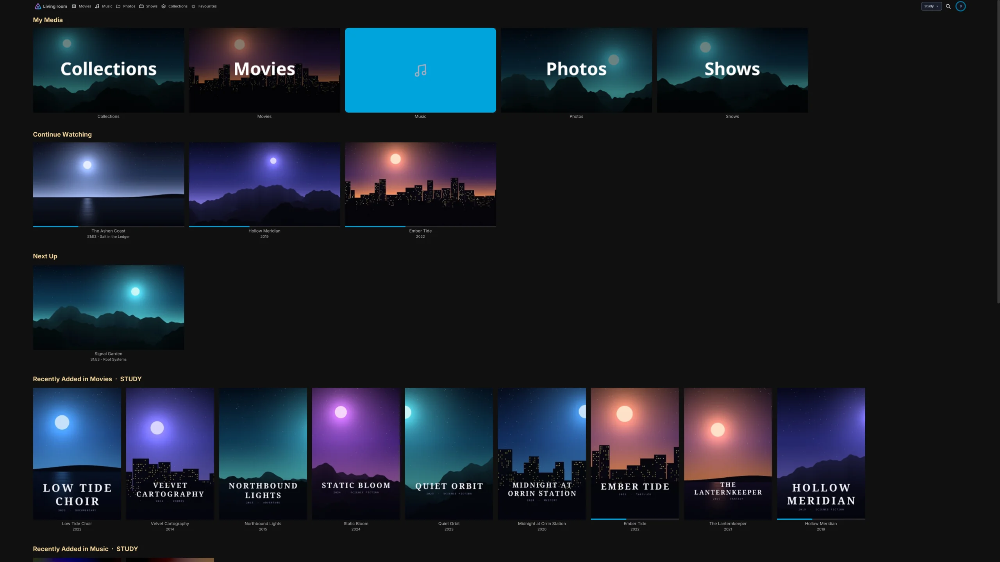
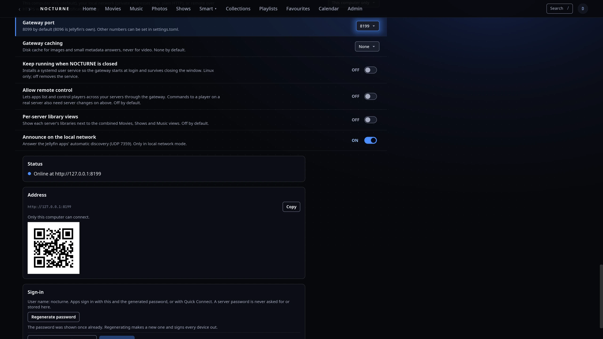
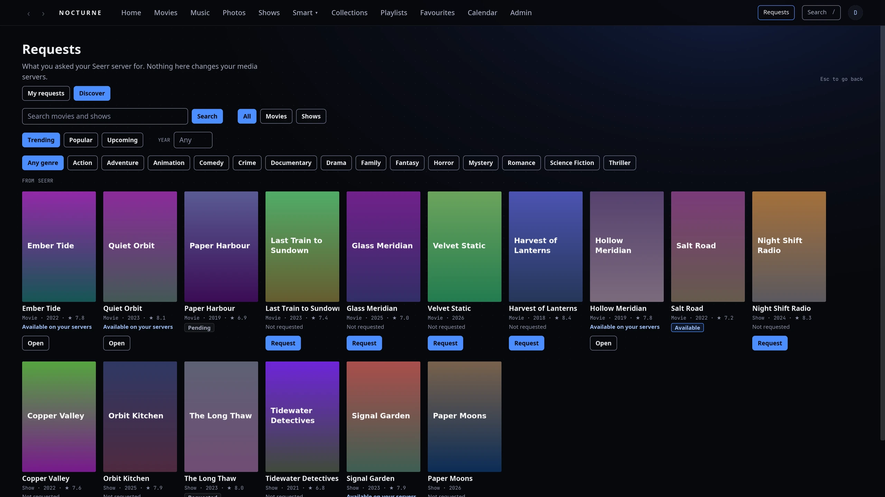

<p align="center"></p>

<h1 align="center">NOCTURNE</h1>

<p align="center"><strong>Your media. Your night.</strong></p>

<p align="center">A native media center written in Rust. Local folders and any number of Jellyfin servers appear as one library, and video plays inside the app window.</p>

<p align="center">
<a href="https://nocturne.ifsvivek.in">Website</a> ·
<a href="https://github.com/ifsvivek/nocturne/releases/latest">Download</a> ·
<a href="docs/README.md">Docs</a> ·
<a href="CHANGELOG.md">Changelog</a>
</p>

<p align="center">
<a href="https://github.com/ifsvivek/nocturne/releases/latest"></a>
<a href="LICENSE"></a>

</p>


<!--
Screenshots to capture for each release, from the generated demo library (scripts/make-demo-library.sh):
docs/screenshots/home.webp       Home with the hero, Continue Watching and a latest row
docs/screenshots/detail.webp     A movie page with the versions and sources picker open
docs/screenshots/player.webp     In-window playback with the controls shown
docs/screenshots/themes.webp     Settings > Themes with the built-in themes
docs/screenshots/studio.webp     Theme Studio with an element picked on Home
docs/screenshots/server-look.webp  Home drawn in a server's own look (Jellyfin layout mode)
docs/screenshots/calendar.webp   Calendar, week view, with entries marked On your server, Airing soon and Not on your servers (make-demo-library.sh build --upcoming)
docs/screenshots/requests.webp   The Requests page (throwaway Seerr, scripts/test-seerr.sh)
docs/screenshots/gallery.webp    Settings > Themes, Gallery view with the Official cards
docs/screenshots/gateway.webp    Settings > Gateway with the gateway on (loopback address, demo data)
docs/screenshots/discover.webp   Requests > Discover (scripts/mock-requests.py)
-->

| | |
|---|---|
|  |  |
|  |  |
|  |  |
|  | |

Screenshots show a generated demo library, not personal media.

## Highlights

- One library over local folders and any number of Jellyfin servers, each with its own account. A title found in several places appears once, with the other copies offered as versions and sources.
- Local folders are scanned for names, `.nfo` files and sidecar artwork. Files are never modified, moved or deleted.
- Video plays inside the app window through libmpv with hardware decoding, or in VLC or an mpv window if you prefer. HDR video is tone-mapped to SDR, with an optional HDR pop-out window.
- Themes are CSS, drawn by a native engine with no browser inside. A gallery installs the official ones in a click, Theme Studio edits any element of the live screens, and each server can use its own look.
- A Calendar of upcoming episodes from your servers and Trakt, and optional requests to a Seerr server for titles you do not have yet.
- A gateway for your phone and TV: one Jellyfin-compatible address over all your servers and folders, so Jellyfin apps can browse and play from it. Off by default, Linux only for now.
- A Requests button with a Discover view of trending, popular and upcoming titles, and requests through Seerr, or kept on your computer with optional Radarr and Sonarr.
- Read-only by default: nothing on a server changes until you switch on server changes in Settings.
- Signed pacman, apt and dnf repositories, and in-app updates for per-user installs.
- Trakt scrobbling and history import, SyncPlay for watching together, and playlists, a music queue and offline copies.
- An admin area for server owners: users, libraries, tasks, devices, logs, plugins and more, each change behind a confirmation dialog.

The complete list is in [docs/FEATURES.md](docs/FEATURES.md).

## Install

Linux on x86_64 under Wayland is the supported platform. Arch is the primary test target.

<details>
<summary><strong>Arch Linux and derivatives</strong> (package repository, recommended)</summary>

Signed packages; NOCTURNE then updates with the rest of your system. pacman installs `mpv` and every other runtime library. Step-by-step page: [nocturne.ifsvivek.in/repo](https://nocturne.ifsvivek.in/repo).

```sh
# 1. Trust the NOCTURNE signing key
curl -fsSL https://nocturne.ifsvivek.in/repo/ARCH-GPG-KEY | sudo pacman-key --add -
sudo pacman-key --lsign-key 5204B42AF768DE210D4979E397FA02EFCF1A4E3B

# 2. Add the repository (one line; works in bash, zsh and fish)
printf '%s\n' '' '[nocturne]' 'SigLevel = Required TrustedOnly' 'Server = https://nocturne.ifsvivek.in/repo/arch/$arch' | sudo tee -a /etc/pacman.conf

# 3. Install
sudo pacman -Syu nocturne
```

The key fingerprint is `5204 B42A F768 DE21 0D49 79E3 97FA 02EF CF1A 4E3B`. To build the package yourself, run `makepkg -si` in `packaging/` after cloning the repository.

</details>

<details>
<summary><strong>Debian 13, Ubuntu 24.04 and newer</strong> (apt repository)</summary>

```sh
curl -fsSL https://nocturne.ifsvivek.in/repo/NOCTURNE-GPG-KEY.gpg | sudo tee /usr/share/keyrings/nocturne.gpg >/dev/null
echo 'deb [signed-by=/usr/share/keyrings/nocturne.gpg] https://nocturne.ifsvivek.in/repo/deb stable main' | sudo tee /etc/apt/sources.list.d/nocturne.list
sudo apt update && sudo apt install nocturne
```

Check the key with `gpg --show-keys /usr/share/keyrings/nocturne.gpg`; the fingerprint is the one above. On Ubuntu 24.04 (libmpv 0.37) video plays in a separate mpv window.

</details>

<details>
<summary><strong>Fedora</strong> (dnf repository)</summary>

mpv's library comes from RPM Fusion (free), so enable it first.

```sh
sudo dnf install https://mirrors.rpmfusion.org/free/fedora/rpmfusion-free-release-$(rpm -E %fedora).noarch.rpm
sudo dnf config-manager addrepo --from-repofile=https://nocturne.ifsvivek.in/repo/rpm/nocturne.repo
sudo dnf install nocturne
```

`dnf` asks once to import the signing key; compare the fingerprint above and answer `y`. The `addrepo` form is dnf5 (Fedora 41 and newer). On dnf4 use `sudo dnf config-manager --add-repo https://nocturne.ifsvivek.in/repo/rpm/nocturne.repo`.

</details>

<details>
<summary><strong>Other distributions</strong> (release tarball)</summary>

```sh
curl -LO https://github.com/ifsvivek/nocturne/releases/download/v0.7.0/nocturne-0.7.0-x86_64-linux.tar.gz
curl -LO https://github.com/ifsvivek/nocturne/releases/download/v0.7.0/nocturne-0.7.0-x86_64-linux.tar.gz.sha256
sha256sum -c nocturne-0.7.0-x86_64-linux.tar.gz.sha256
tar xf nocturne-0.7.0-x86_64-linux.tar.gz && cd nocturne-0.7.0-x86_64-linux
sudo ./install.sh              # installs to /usr/local (PREFIX changes it); `sudo ./install.sh uninstall` removes it
```

The installer checks the runtime libraries and installs missing ones with your package manager (it prints the command first; `--no-deps` skips this). The binary is built on current Arch and needs a recent glibc.

</details>

<details>
<summary><strong>Windows and macOS</strong> (unsigned previews)</summary>

Both are attached to the [GitHub release](https://github.com/ifsvivek/nocturne/releases/latest) and are unsigned, so the system warns on first start. Video plays in mpv's own window on macOS. Details: [docs/PLATFORMS.md](docs/PLATFORMS.md).

</details>

<details>
<summary><strong>Build from source</strong></summary>

libmpv is loaded at run time, so no development files are needed.

```sh
# Arch: sudo pacman -S rust pkgconf mpv vulkan-icd-loader libxkbcommon
# Debian/Ubuntu (names may differ): pkg-config libvulkan1 libxkbcommon0 libwayland-client0 libdbus-1-dev libmpv2
git clone https://github.com/ifsvivek/nocturne && cd nocturne
cargo build --release --locked      # stable Rust 1.89+; a clean release build takes several minutes (fat LTO)
./target/release/nocturne
```

</details>

Optional: VLC, if you want to play in it (Settings > Video player > Player). NOCTURNE detects it and never bundles it.

Runtime needs: a Wayland session, a Vulkan driver, EGL, libmpv (or the `mpv` program), and a Secret Service provider (gnome-keyring, KWallet or KeePassXC) to remember sign-ins. Problems starting the app are covered in [docs/README.md](docs/README.md#troubleshooting).

## Getting started

1. Start NOCTURNE. The first-run setup asks whether you want a local library, a server, or both.
2. For a local library, add a folder. For a server, enter its address and sign in with a password or Quick Connect.
3. Browse, search with Ctrl+K or `/`, and press `?` for the keyboard shortcuts.
4. Everything else is in Settings: sources, themes, playback, updates and the opt-in features.

## Gateway

The gateway makes NOCTURNE answer as a Jellyfin server of its own, so a phone or TV app can use it. It is off by default and Linux only for now.

1. Open Settings > Gateway and switch it on. The page shows the address (loopback by default, with a QR code) and a generated password, shown once.
2. In the Jellyfin app, add that address and sign in as `nocturne` with the password, or choose Quick Connect and approve the code on the same page.
3. A phone needs more than loopback: set "Allow connections from" to the local network. That serves plain HTTP to devices on your own network only. For anywhere else, use your own HTTPS certificate or a private overlay such as Tailscale.

No server token or file path ever reaches an app, remote control is a separate switch, and changes to a server follow your server-changes setting. The official phone and TV apps have not been tried yet; see [docs/dev/GATEWAY_PLAN.md](docs/dev/GATEWAY_PLAN.md).

## Privacy and safety

NOCTURNE changes nothing on a server unless you turn on `allow_server_writes` in Settings. Sign-in tokens live only in the system keyring, and files in your media folders are never modified. Which actions write to a server, and when, is listed in [docs/WRITES.md](docs/WRITES.md).

## Documentation

See [docs/README.md](docs/README.md) for the full index: [Features](docs/FEATURES.md), [Sources](docs/SOURCES.md), [Platforms](docs/PLATFORMS.md), [Roadmap](docs/ROADMAP.md) and [Architecture](docs/ARCHITECTURE.md).

## Contributing

Pull requests are welcome. [CONTRIBUTING.md](CONTRIBUTING.md) covers setup, the throwaway-server test workflow and the ground rules. Coding agents should also read [CLAUDE.md](CLAUDE.md) and [AGENTS.md](AGENTS.md). Report security problems as described in [SECURITY.md](SECURITY.md).

## License

GPL-3.0-or-later. See [LICENSE](LICENSE); third-party licences are listed in [THIRD_PARTY_NOTICES.md](THIRD_PARTY_NOTICES.md).

NOCTURNE is not affiliated with, endorsed by or sponsored by the Jellyfin project.

## Acknowledgements

- [Jellyfin](https://jellyfin.org/) is the media server NOCTURNE works with. "Jellyfin" and its logo are trademarks of the Jellyfin project, used here only to say which server this client talks to.
- [Iced](https://iced.rs/) is the UI framework (MIT).
- [mpv](https://mpv.io/) and libmpv provide playback and hardware decoding.
- [Rust](https://www.rust-lang.org/) and the crates NOCTURNE builds on, including tokio, reqwest, rustls, serde, zbus, keyring, wayland-client and image. Licences are in [THIRD_PARTY_NOTICES.md](THIRD_PARTY_NOTICES.md).
