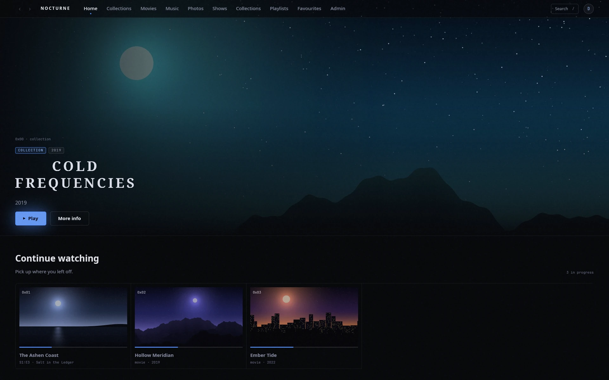
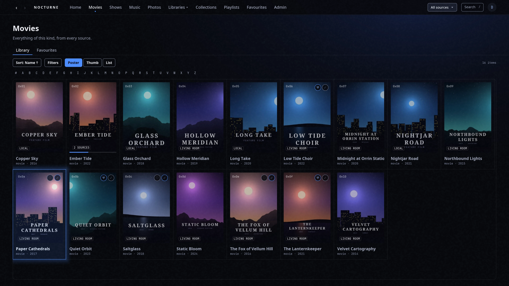
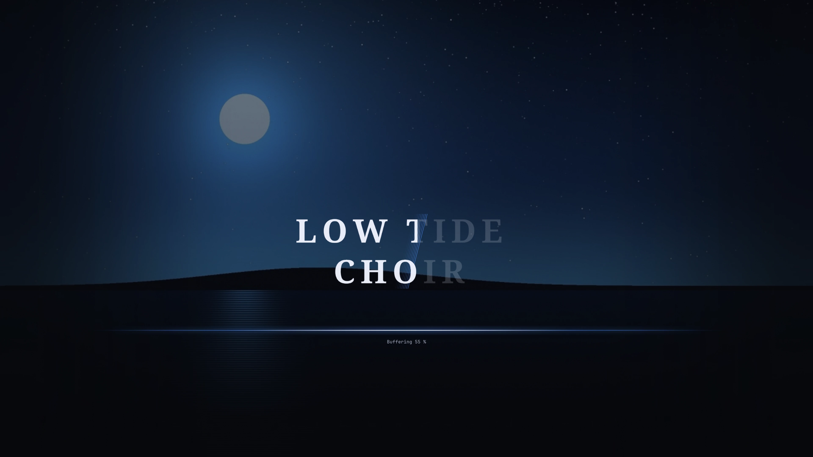
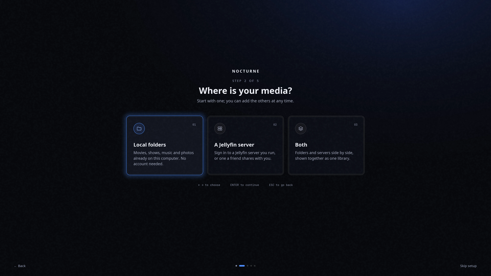
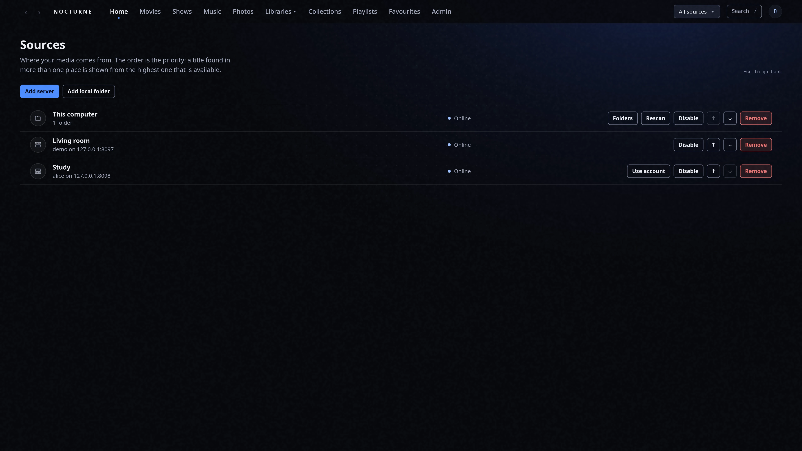
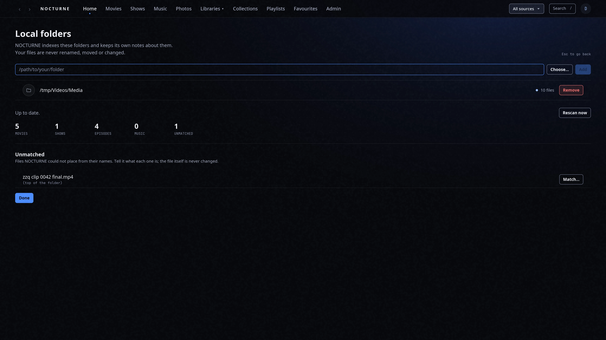
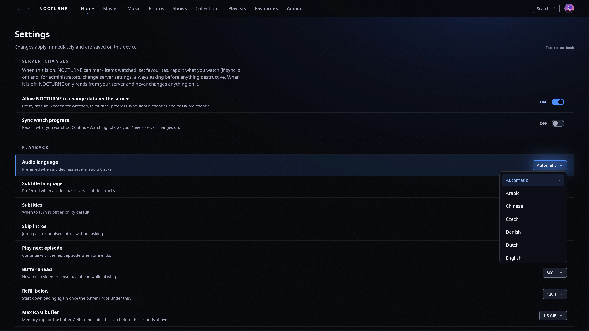
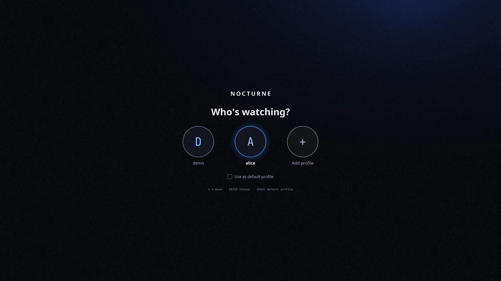
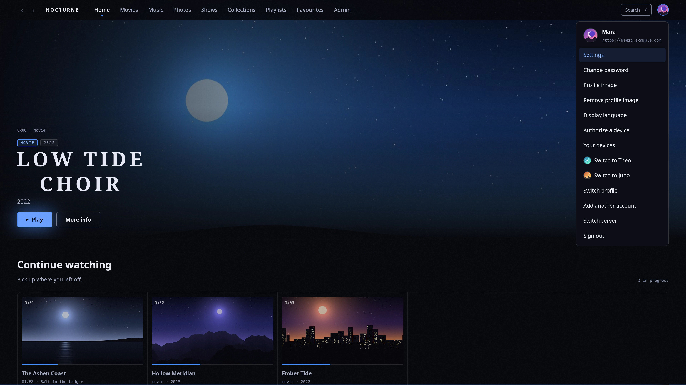
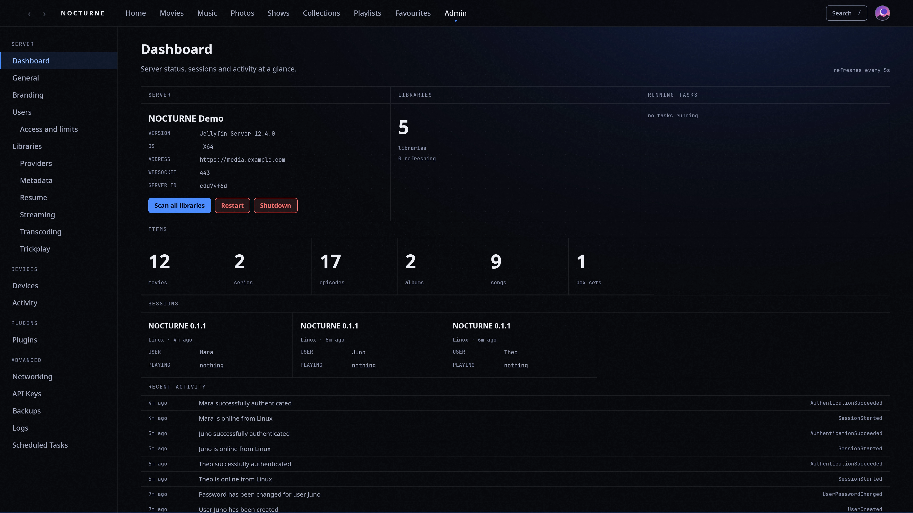

<p align="center"></p>

# NOCTURNE

**YOUR MEDIA. YOUR NIGHT.**

A native media center for Linux: local folders and Jellyfin servers in one cinematic library.

Built with Rust, [Iced](https://iced.rs/), libmpv, Tokio and the Jellyfin REST API. Video plays inside the app window
through libmpv with hardware decoding on Wayland; on X11 it plays in an external mpv window.

[Website](https://nocturne.ifsvivek.in) · [Download](https://github.com/ifsvivek/nocturne/releases/latest) · [Features](docs/FEATURES.md) · [Roadmap](docs/ROADMAP.md) · [Changelog](CHANGELOG.md)

Status: version 0.3, early software, Linux x86_64 (tested on Arch only); macOS and Windows are planned, not available
yet ([docs/PLATFORMS.md](docs/PLATFORMS.md)). See [docs/ROADMAP.md](docs/ROADMAP.md) for what is coming and what is missing.

## Screenshots

Captured from 0.3.0 at 3840x2160 against a generated demo library (two demo servers and a demo folder), not personal media.

|                                                           |                                                               |
| --------------------------------------------------------- | ------------------------------------------------------------- |
|  |  |
|  |   |
|     |                        |
|    |           |
|                  |          |
|                |  |
|            |            |
|            |                                                               |

## What it does

The full checklist is [docs/FEATURES.md](docs/FEATURES.md); verification notes are in
[docs/QA_REPORT.md](docs/QA_REPORT.md).

- **One library from many sources**: use local media folders only, one or several Jellyfin servers (each with its own
  account), or both. The same title found in several places appears once, with the other copies offered as versions and
  sources on its detail page. A short first-run setup asks which of the three you want (repeat it from Settings); **Settings > Sources** manages
  servers and folders afterwards.
- **Guided setup, one window**: the first-run flow can be repeated from Settings, and launching NOCTURNE again raises the running window.
- **Local library**: add folders, NOCTURNE scans them (names, `.nfo` files and sidecar artwork; `ffprobe` adds stream
  details if installed), shows scan progress, lists what it could not match and lets you match it by hand. Your files are
  never modified, moved or deleted.
- **Versions and sources**: one picker lists the versions a server offers (for example 4K and 1080p) and the copies on
  other servers or in local folders; choose one, and optionally always prefer it.
- **Browse**: home with Continue Watching and Next Up, libraries with sort, filters, A-Z and poster / thumb / list views,
  genres, studios, years, tags, collections, playlists and favourites, global search (Ctrl+K or `/`), people pages.
- **Details**: movie, series, season and episode pages with cast, chapters, similar items, extras and media info.
- **Playback**: in-window video via libmpv with hardware decoding on Wayland (external mpv window on X11), a loading
  splash that fills as the stream buffers, chapters and trickplay on the seek bar, audio and subtitle menus with delays
  and styling, speed and picture controls, skip intro and credits, next-episode autoplay, queue, quality selector with
  transcode fallback, mini player, MPRIS and idle inhibit.
- **Accounts**: username and password or Quick Connect (and authorizing other devices); switch between remembered accounts
  without a password, with a "Who's watching?" profile picker at launch; tokens live in your system keyring.
- **Watch together**: SyncPlay groups on a server; play, pause, seek and skip stay in step for everyone (press `g`).
- **Playlists and music**: create, edit, reorder and delete your playlists; a music queue with play next, shuffle and repeat.
- **Admin** (administrator accounts): dashboard, users, libraries, providers, scheduled tasks, devices, activity, logs,
  API keys, branding, networking, transcoding, trickplay, backups and plugins, per server, each change behind a
  confirmation dialog.
- **Comfort**: a reduce-motion setting that follows the desktop preference, keyboard-first navigation, key help (`?`).

Not implemented: Live TV, DLNA, casting, gapless music, playable books and audiobooks, online metadata lookup for local
files, and a few admin settings (HTTPS and proxy editing, access schedules). Windows and macOS are not supported yet.

## Install

NOCTURNE plays video with mpv's library, libmpv (package `mpv` on Arch, `libmpv2` on Debian/Ubuntu, `mpv-libs` on
Fedora), and needs a Vulkan driver, an OpenGL/EGL stack and a Secret Service provider (gnome-keyring, KWallet or
KeePassXC) to remember logins. libmpv is loaded when needed, so the app starts and browses even without it. Packages are
tested on Arch Linux only; see [docs/PACKAGING.md](docs/PACKAGING.md) for the full dependency list.

**Package repository (Arch, recommended)**: signed, updates with `pacman -Syu`. pacman pulls in `mpv` and the other
runtime libraries:

```sh
curl -fsSL https://nocturne.ifsvivek.in/repo/ARCH-GPG-KEY | sudo pacman-key --add -
sudo pacman-key --lsign-key 5204B42AF768DE210D4979E397FA02EFCF1A4E3B
printf '\n[nocturne]\nSigLevel = Required TrustedOnly\nServer = https://nocturne.ifsvivek.in/repo/arch/$arch\n' | sudo tee -a /etc/pacman.conf
sudo pacman -Syu nocturne
```

Signing key fingerprint: `5204B42AF768DE210D4979E397FA02EFCF1A4E3B` (compare it with the output of the second command).

**Arch Linux, from source** (builds from the source archive of the release tag; the `PKGBUILD` is attached to the release and lives in
`packaging/`). pacman pulls in `mpv` and the other runtime libraries:

```sh
git clone https://github.com/ifsvivek/nocturne && cd nocturne/packaging && makepkg -si
```

**Release tarball** (from the [latest release](https://github.com/ifsvivek/nocturne/releases/latest)):

```sh
sha256sum -c nocturne-VERSION-x86_64-linux.tar.gz.sha256
tar xf nocturne-VERSION-x86_64-linux.tar.gz && cd nocturne-VERSION-x86_64-linux
sudo ./install.sh              # PREFIX=/usr/local by default; `sudo ./install.sh uninstall` removes it
```

The installer checks every runtime library and installs the missing ones with your distribution's package manager
(it prints the command first; `--no-deps` skips this). The binary is built on Arch and needs a current glibc, so on
other distributions it may refuse to start: build from source there.

**From source** (no libmpv development files needed; libmpv is loaded at run time):

```sh
# Arch: sudo pacman -S rust pkgconf libxkbcommon-x11 vulkan-icd-loader mpv
# Debian/Ubuntu (names may differ): pkg-config libxkbcommon-x11-dev libvulkan1 libwayland-dev libdbus-1-dev
git clone https://github.com/ifsvivek/nocturne && cd nocturne
cargo build --release --locked      # needs stable Rust 1.89+
./target/release/nocturne
```

A clean release build takes several minutes (fat LTO).

## Supported environments

| Area | Status |
|---|---|
| OS and architecture | Linux, x86_64. macOS and Windows are planned, not available yet ([docs/PLATFORMS.md](docs/PLATFORMS.md)). |
| Packages | Tested on Arch Linux only (see [docs/PACKAGING.md](docs/PACKAGING.md)). Other distributions should build from source but are unverified. |
| Wayland | In-window video (libmpv in a subsurface, hardware decoding). Developed and tested here, on NVIDIA proprietary drivers; AMD and Intel GPUs are untested. |
| X11 | The interface works; video plays in an external mpv window that closes with the app. Tested through Xwayland. |
| Servers | Jellyfin 12.4 (a real server and a throwaway one); several servers at once. Other versions are untested; other media servers are not supported. |
| Local media | Folders on this computer; video, audio and image files. |
| Needed at run time | A Vulkan driver, EGL, a Secret Service provider to remember logins; libmpv (or the `mpv` program) to play video |

## Troubleshooting

- **The window does not open or is blank.** The interface renders with Vulkan: check that a Vulkan driver is installed
  (`vulkaninfo --summary`). Run `nocturne` from a terminal to see its messages.
- **Playing says libmpv is missing.** The app falls back to the `mpv` program if it is installed, and otherwise shows what
  to install for your distribution (`mpv` on Arch, `libmpv2` on Debian/Ubuntu, `mpv-libs` on Fedora). Browsing keeps working.
- **Video opens in a separate mpv window.** That is the behaviour on X11, with `NOCTURNE_VIDEO=external`, or when the
  Wayland surface cannot be set up (the terminal says `video: embedded unavailable`). `NOCTURNE_VO` picks that window's
  video output.
- **HDR video looks like SDR.** Video inside the window is tone-mapped to SDR (mpv's embedding API cannot output HDR). An
  HDR pop-out window is planned for 0.4 ([docs/HDR.md](docs/HDR.md)).
- **"No system keyring found".** No Secret Service provider is running, so you will sign in again next time. Start
  gnome-keyring, KWallet or KeePassXC with the Secret Service integration enabled; NOCTURNE never writes tokens to a file.
- **A source shows "Signed out".** That server revoked the login; use *Sign in again* in Settings > Sources. Other
  sources are not affected. A server that does not answer shows "Offline" and is retried with backoff.
- **A local folder shows as unavailable.** Its drive is probably not mounted; items return when it is. Nothing is removed
  while a folder is away.
- **Progress, watched or favourite changes do nothing.** They are off by default: enable
  **Settings > Allow NOCTURNE to change data on the server** ([docs/WRITES.md](docs/WRITES.md)).
- **Reporting a bug.** Use the issue template and remove access tokens, server addresses and usernames from any
  logs before posting.

## Usage notes

- **Fonts.** The UI uses Noto Sans and JetBrainsMono Nerd Font if installed, and falls back to system fonts.
- **Window opacity.** Some compositors apply a window opacity rule to every window; the video then looks washed out in a
  floating window. Exempt the app id `nocturne` ([docs/video-embedding.md](docs/video-embedding.md)).
- **Accessibility.** Keyboard navigation and visible focus work everywhere; screen-reader support is limited by what
  Iced exposes today.

## Configuration and keyring

- Settings: `$XDG_CONFIG_HOME/nocturne/settings.toml` (default `~/.config/nocturne/`). Preferences only.
- Sources: `$XDG_CONFIG_HOME/nocturne/sources.toml` lists your servers (URL, user name, label) and local folders, their
  order and whether each is enabled. No secrets. Upgrading from 0.2, your server login becomes a source automatically;
  the old `servers.toml` and `accounts.toml` are left in place.
- Login tokens: your system keyring (Secret Service), one per server account, never a file.
- Local library: the index, your manual matches and local watch state live under `$XDG_DATA_HOME/nocturne/local/`
  (default `~/.local/share/nocturne/local/`). Deleting that directory only forgets what NOCTURNE learned; your media
  files are untouched.
- Developer mode: `NOCTURNE_JF_URL` and `NOCTURNE_JF_TOKEN` (a Jellyfin API key) add a transient, read-only source that is
  never saved. Debug builds also read them from a git-ignored `.env`; release builds never read `.env`.

## Safety model: read-only by default

NOCTURNE changes nothing on any server unless you say so. One setting,
**Settings > Allow NOCTURNE to change data on the server** (`allow_server_writes`), is off by default and gates
everything that writes to a server: playback progress, watched and favourite flags, own password and every admin
action, and each change goes only to the server the item came from. Admin actions additionally need an administrator
account and a confirmation dialog. Signing in and out only creates and ends this app's own session. Local files are
never modified, moved or deleted; watch state for local items is kept in NOCTURNE's own data directory. The browsing
and playback crate is GET-only and a test enforces it. Details and the full table: [docs/WRITES.md](docs/WRITES.md).

## Contributing and AI-agent friendly

Contributions are welcome: see [CONTRIBUTING.md](CONTRIBUTING.md) for setup, the throwaway-server test workflow and
the ground rules. The repository is set up so coding agents can work in it safely: [CLAUDE.md](CLAUDE.md) (also
referenced from [AGENTS.md](AGENTS.md)) has the crate map, commands and safety rules, and
[docs/ARCHITECTURE.md](docs/ARCHITECTURE.md) explains how the pieces fit together.

## Documentation

[Features](docs/FEATURES.md) | [Architecture](docs/ARCHITECTURE.md) | [Decisions](docs/DECISIONS.md) |
[Sources](docs/SOURCES.md) | [Platforms](docs/PLATFORMS.md) | [Design](docs/DESIGN.md) | [Roadmap](docs/ROADMAP.md) | [Writes](docs/WRITES.md) | [Packaging](docs/PACKAGING.md) | [QA report](docs/QA_REPORT.md) |
[Contributing](CONTRIBUTING.md) | [Security](SECURITY.md) | [Changelog](CHANGELOG.md)

## License

GPL-3.0-or-later. See [LICENSE](LICENSE); third-party licences are listed in
[THIRD_PARTY_NOTICES.md](THIRD_PARTY_NOTICES.md).

## Acknowledgements and attribution

- **[Jellyfin](https://jellyfin.org/)** is the media server NOCTURNE talks to. "Jellyfin" and its logo are trademarks of
  the Jellyfin project. NOCTURNE is an unofficial third-party client; it is not affiliated with, endorsed by or
  sponsored by Jellyfin, and uses the name only to say which server it works with.
- **[Iced](https://iced.rs/)**, the UI framework (MIT). 0.2.0 used GPUI by Zed Industries instead; 0.3 replaced it.
- **[mpv](https://mpv.io/) / libmpv** for playback and hardware decoding.
- **[Rust](https://www.rust-lang.org/)** and the crates NOCTURNE builds on, including tokio, reqwest, rustls, serde, zbus,
  keyring, wayland-client and image. The full list with licences is in [THIRD_PARTY_NOTICES.md](THIRD_PARTY_NOTICES.md).

---

> **Unofficial. Not affiliated with, endorsed by or sponsored by the Jellyfin project.**
> NOCTURNE is an independent client that talks to your own Jellyfin server over its public API.
